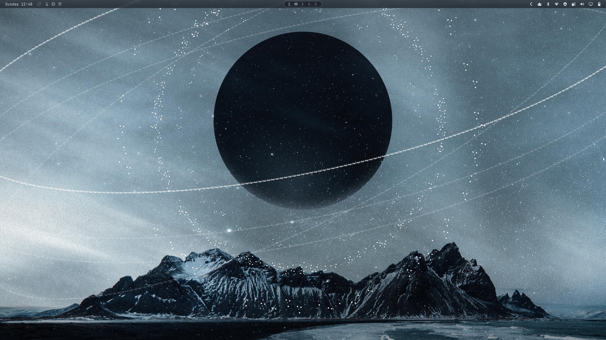
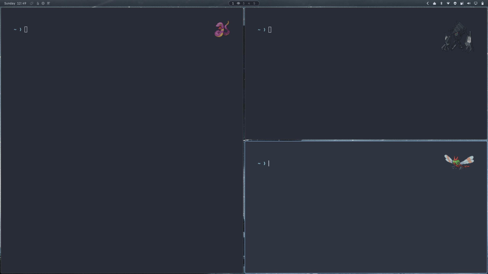

<div align="center">

# omarchy-dotfiles

**My personal [Omarchy](https://omarchy.org) setup: a frosted-glass top bar, per-monitor wallpapers, linked workspaces across monitors, and a terminal setup with a Pokémon in every window.**

[](https://omarchy.org)
[](https://hypr.land)
[](https://archlinux.org)
[](https://fishshell.com)
[](https://neovim.io)





</div>

---

## Contents

- [Quick start](#quick-start)
- [Features](#features)
  - [Top bar](#top-bar)
  - [Wallpapers](#wallpapers)
  - [Windows and monitors](#windows-and-monitors)
  - [Workspace links](#workspace-links)
  - [Look and feel](#look-and-feel)
  - [Notifications and reminders](#notifications-and-reminders)
  - [Terminal](#terminal)
  - [Shell](#shell)
  - [Neovim](#neovim)
  - [Dictation](#dictation)
  - [Themes](#themes)
- [Keybindings](#keybindings)
- [What the installer does](#what-the-installer-does)
- [Repository layout](#repository-layout)
- [Per-machine settings](#per-machine-settings)
- [Keeping it in sync](#keeping-it-in-sync)
- [Credits](#credits)

---

## Quick start

Start from a fresh [Omarchy](https://omarchy.org) install, then open a terminal and run:

```bash
git clone https://github.com/ewush956/omarchy-dotfiles ~/omarchy-dotfiles
cd ~/omarchy-dotfiles
./install.sh
```

Log out and back in when it finishes.

| Command | What it does |
|---|---|
| `./install.sh` | Core packages, all config, community themes, fish as login shell |
| `./install.sh --optional` | Also installs the heavier apps in [`packages/optional.txt`](packages/optional.txt) |
| `./install.sh --config-only` | Only copies config (e.g. after `git pull`) |

Nothing gets lost: every file the installer replaces in `~/.config` is first
backed up to `~/.config-backup/<timestamp>/`, and it's safe to run again.

Nothing here depends on specific hardware. Displays are auto-detected, and the
config works with one monitor or several.

---

## Features

### Top bar

The stock Omarchy bar, restyled and rearranged.

- **Liquid style:** a custom preset for [Rice Bar](https://github.com/jcarcinogen/omarchy-rice-bar)
  that draws a full-width frosted sheet (34% opacity, 11px radius) with a raised
  workspace pill in the center, with real Hyprland blur behind it. Rice Bar's
  stock presets (Outline, Islands, Pills, Glow, …) are still a click away in its
  panel, and its own button is hidden to keep the bar clean.
- **Left:** clock (`Sunday 12:48`, click for the full date and week number),
  keyboard layout, update notice, weather, and status indicators.
- **Center:** per-monitor workspace numbers with a link/unlink chain (see
  [Workspace links](#workspace-links)).
- **Right:** tray, agents, Bluetooth, network, audio, display and power.
- **Weather** (`ewse.weather`): icon sized and dimmed to sit quietly with the
  other indicators; it brightens while its forecast panel is open.
- **Indicators** (`ewse.indicators`): pending reminder, screen recording, and a
  clickable Stay Awake toggle that keeps the screen from locking.

### Wallpapers

- **A different wallpaper on every monitor** (`ewse.background` +
  `ewse.wallpapers`). The picker shows one carousel row per connected monitor:
  <kbd>←</kbd>/<kbd>→</kbd> choose an image, <kbd>↑</kbd>/<kbd>↓</kbd> switch
  monitors, <kbd>Enter</kbd> applies.
- Open it with <kbd>Super</kbd>+<kbd>Ctrl</kbd>+<kbd>Space</kbd>, from the menu
  (**Style → Background**), or by double-clicking the desktop.
- Changing theme or using Omarchy's own background commands falls back to one
  wallpaper everywhere, like stock.

### Windows and monitors

- **Swap windows across monitors:** <kbd>Super</kbd>+<kbd>Shift</kbd>+arrows
  swaps with the neighbour in that direction, even when it's on another monitor.
  If the next monitor is empty the window just moves there. Left/right wrap
  around from the last monitor to the first.
- **Focus wraps too:** <kbd>Super</kbd>+<kbd>←</kbd>/<kbd>→</kbd> past the
  outermost monitor jumps to the far side.
- **One browser window on login:** Zen Browser otherwise reopens every window
  from the last session. A small launcher trims the saved session to one window
  first (pinned tabs, Essentials and Spaces are kept).
- **Floating windows** still nudge normally with the same keys.

### Workspace links

Replaces Omarchy's ten-per-monitor workspaces with the classic model: each
monitor owns a few fixed workspace numbers, so <kbd>Super</kbd>+<kbd>N</kbd>
always means the same place. Full docs: [`config/hypr/workspace-links.md`](config/hypr/workspace-links.md).

- **Fixed layout:** e.g. main monitor 1–3, second 4–6, third 7–9; one monitor on
  its own gets 1–5.
- **Linked cycling:** <kbd>Super</kbd>+<kbd>Tab</kbd> steps the focused monitor
  *and every monitor linked to it*, each from its own position.
  <kbd>Super</kbd>+<kbd>Ctrl</kbd>+<kbd>Tab</kbd> steps just the focused one.
- **Link/unlink** a monitor with <kbd>Super</kbd>+<kbd>Shift</kbd>+<kbd>L</kbd>
  or by clicking the chain in the bar. Links are remembered per monitor setup.
- **Undock and re-dock:** windows from a monitor that's unplugged move into
  empty workspaces on the others, then go back to where they came from (matched
  by app) when it returns.
- Workspace scrolling and moving whole workspaces between monitors are turned off.

### Look and feel

From [`config/hypr/looknfeel.lua`](config/hypr/looknfeel.lua):

- Tight 2px gaps and 2px borders, 4px rounded corners.
- Unfocused windows dimmed by 15%, so the active one stands out.
- Every window fully opaque (overriding theme transparency), with blur reserved
  for the bar.

### Notifications and reminders

- **Reminders stay on screen until dismissed** (`ewse.notifications`), so they
  can't be missed. Everything else still fades out on its own; low battery stays
  sticky as in stock Omarchy.
- <kbd>Super</kbd>+<kbd>R</kbd> opens the reminder prompt.

### Terminal

**kitty** is the default terminal ([`config/kitty/`](config/kitty/)):

- **A random Pokémon in the corner of every new window.** It's pinned to the
  window so it stays put while output scrolls, and hides while full-screen apps
  (Neovim, tmux, less) are open. Sprites come from PokéAPI.
- JetBrains Mono Nerd Font 13, beam cursor with a trail, roomy margins.
- <kbd>Ctrl</kbd>+<kbd>F</kbd> opens incremental scrollback search in a split.
- <kbd>Ctrl</kbd>+<kbd>C</kbd> copies when text is selected and interrupts when
  not; <kbd>Ctrl</kbd>+<kbd>+</kbd>/<kbd>-</kbd>/<kbd>0</kbd> resize the font.
- Colors follow the current Omarchy theme.

**tmux** ([`config/tmux/tmux.conf`](config/tmux/tmux.conf)): prefix
<kbd>Ctrl</kbd>+<kbd>Space</kbd>, vi copy mode, <kbd>Alt</kbd>+<kbd>Enter</kbd> /
<kbd>Alt</kbd>+<kbd>Shift</kbd>+<kbd>Enter</kbd> to split in the current
directory. Launch with <kbd>Super</kbd>+<kbd>Alt</kbd>+<kbd>Return</kbd>.

**starship** prompt: just the directory (repo-root aware), git branch and status,
and a `❯`.

Configs for ghostty, alacritty and foot are included too.

### Shell

**fish** replaces Omarchy's default bash ([`config/fish/config.fish`](config/fish/config.fish)):

- **All of Omarchy's bash aliases ported**, and its bash-only helper functions
  (`tdl`, `compress`, `iso2sd`, …) wrapped to run from fish, including new
  ones added in future Omarchy updates.
- `cd` is zoxide (jumps to frequent directories), plus fzf key bindings, mise
  and direnv.
- `ff`: fuzzy file finder with previews (images shown inline in kitty).
- Git shortcuts (`g`, `gp`, `ga`, `gcm`, `gcam`, …), `lt` tree view, `n` opens
  Neovim (on `.` by default), `open` launches files detached.
- `make_python_venv [version]`: creates a pyenv-pinned `.venv` with
  `requirements.txt`, `.gitignore` and direnv auto-activation in one step.
- `newassignment`: scaffolds a LaTeX assignment from a template.

### Neovim

[LazyVim](https://lazyvim.org) based ([`config/nvim/`](config/nvim/)):

- **Follows the Omarchy theme** and live-reloads when you switch themes; ships
  with the colorschemes of every stock theme.
- **LaTeX:** vimtex, LaTeX symbol completion, custom snippets and keymaps, an
  in-editor PDF viewer.
- **Notebooks:** Jupyter via molten + jupytext + NotebookNavigator, with images
  rendered inline (image.nvim).
- **Markdown** rendered in the buffer (render-markdown), pandoc citation completion.
- Code runner, conform formatting, telescope, trouble, Mason-managed LSPs.

### Dictation

Local speech-to-text with [Voxtype](https://voxtype.io) (Whisper `base.en`,
nothing leaves the machine). Text is typed into whatever window is focused.

- <kbd>Super</kbd>+<kbd>Ctrl</kbd>+<kbd>X</kbd> toggles dictation;
  hold <kbd>F9</kbd> for push-to-talk (alongside Omarchy's own keys).
- Media pauses while you speak.

### Themes

**Nord** is active. The installer also clones these community themes, ready in
Omarchy's theme picker:

| | | |
|---|---|---|
| [Anonymous](https://github.com/j4v3l/omarchy-anonymous-theme) | [Ayaka](https://github.com/abhijeet-swami/omarchy-ayaka-theme) | [Blackgold](https://github.com/HANCORE-linux/omarchy-blackgold-theme) |
| [Delorean](https://github.com/jbnunn/omarchy-delorean-theme) | [Florida Man](https://github.com/OldJobobo/omarchy-florida-man-theme) | [Hakker Green](https://github.com/joaquinmeza/omarchy-hakker-green-theme) |
| [Jamaica](https://github.com/j4v3l/omarchy-jamaica-theme) | [Space Monkey](https://github.com/TyRichards/omarchy-space-monkey-theme) | [Vesper](https://github.com/thmoee/omarchy-vesper-theme) |

Add or remove themes in [`themes.txt`](themes.txt); change the default in [`theme`](theme).

---

## Keybindings

Only the changes from stock Omarchy. See all bindings with
`omarchy menu keybindings --print` or <kbd>Super</kbd>+<kbd>K</kbd>.

**Apps**

| Keys | Action |
|---|---|
| <kbd>Super</kbd>+<kbd>Return</kbd> | Terminal (in the current directory) |
| <kbd>Super</kbd>+<kbd>Alt</kbd>+<kbd>Return</kbd> | Terminal with a new tmux session |
| <kbd>Super</kbd>+<kbd>B</kbd> / <kbd>Shift</kbd>+<kbd>B</kbd> | Browser / private window |
| <kbd>Super</kbd>+<kbd>E</kbd> | File manager |
| <kbd>Super</kbd>+<kbd>N</kbd> | Editor |
| <kbd>Super</kbd>+<kbd>T</kbd> | btop |
| <kbd>Super</kbd>+<kbd>D</kbd> | GitHub Desktop |
| <kbd>Super</kbd>+<kbd>O</kbd> | Obsidian |
| <kbd>Super</kbd>+<kbd>/</kbd> | 1Password |

**Web apps**

| Keys | Action |
|---|---|
| <kbd>Super</kbd>+<kbd>A</kbd> / <kbd>Shift</kbd>+<kbd>A</kbd> | ChatGPT / Grok |
| <kbd>Super</kbd>+<kbd>M</kbd> | Gmail |
| <kbd>Super</kbd>+<kbd>Y</kbd> | YouTube |
| <kbd>Super</kbd>+<kbd>G</kbd> | GitHub |
| <kbd>Super</kbd>+<kbd>Shift</kbd>+<kbd>G</kbd> | WhatsApp |
| <kbd>Super</kbd>+<kbd>Alt</kbd>+<kbd>G</kbd> | Google Messages |
| <kbd>Super</kbd>+<kbd>X</kbd> / <kbd>Shift</kbd>+<kbd>X</kbd> | X / new post |

**Windows and workspaces**

| Keys | Action |
|---|---|
| <kbd>Super</kbd>+<kbd>Q</kbd> | Close window |
| <kbd>Super</kbd>+<kbd>←</kbd>/<kbd>→</kbd> | Focus left/right, wrapping around monitors |
| <kbd>Super</kbd>+<kbd>Shift</kbd>+arrows | Swap window in that direction, across monitors |
| <kbd>Super</kbd>+<kbd>Tab</kbd> / <kbd>Shift</kbd>+<kbd>Tab</kbd> | Next / previous workspace on linked monitors |
| <kbd>Super</kbd>+<kbd>Ctrl</kbd>+<kbd>Tab</kbd> / <kbd>Ctrl</kbd>+<kbd>Shift</kbd>+<kbd>Tab</kbd> | Next / previous workspace on this monitor only |
| <kbd>Super</kbd>+<kbd>Shift</kbd>+<kbd>L</kbd> | Link / unlink this monitor |

**System**

| Keys | Action |
|---|---|
| <kbd>Super</kbd>+<kbd>Ctrl</kbd>+<kbd>Space</kbd> | Per-monitor wallpaper picker |
| <kbd>Super</kbd>+<kbd>R</kbd> | Set a reminder |
| <kbd>Super</kbd>+<kbd>W</kbd> | Restart the shell (bar) |
| <kbd>Super</kbd>+<kbd>Ctrl</kbd>+<kbd>X</kbd> | Toggle dictation |
| Hold <kbd>F9</kbd> | Push-to-talk dictation |

---

## What the installer does

1. Installs [`packages/core.txt`](packages/core.txt) (repo and AUR packages are
   sorted automatically) and sets up Voxtype dictation.
2. Copies [`config/`](config/) into `~/.config`, backing up anything it replaces.
3. Writes a workspace-links config for the monitor it finds.
4. Clones the community themes from [`themes.txt`](themes.txt).
5. Asks for your git name and email if none are set (kept out of this repo).
6. Makes fish your login shell.
7. Applies the theme, reloads Hyprland, checks for config errors and restarts
   the bar.

It finishes with a short list of things to do by hand: open Neovim once to
install plugins, set your weather location, pick wallpapers, and sign in to
your apps.

---

## Repository layout

```
omarchy-dotfiles/
├── install.sh                 # set up a machine
├── sync.sh                    # copy this machine's config back into the repo
├── packages/
│   ├── core.txt               # installed by default
│   └── optional.txt           # installed with --optional
├── themes.txt                 # community themes (name + git URL)
├── theme                      # theme applied at install
├── templates/
│   └── workspace-links-config.lua
├── assets/                    # screenshots
└── config/                    # mirrors ~/.config
    ├── hypr/                  # Hyprland (Lua): bindings, look and feel, workspace links
    ├── omarchy/               # shell.json (bar layout), menu, plugins
    │   └── plugins/           # Rice Bar + ewse.* widgets
    ├── kitty/  ghostty/  alacritty/  foot/  tmux/
    ├── fish/   starship.toml
    ├── nvim/
    └── btop/  lazygit/  git/  imv/  mise/  voxtype/  herdr/  latex/  wireplumber/
```

---

## Per-machine settings

These never come from the repo, so each machine keeps its own:

| File | Purpose |
|---|---|
| `~/.config/hypr/monitors.lua` | Monitor modes, positions and scaling (Omarchy's default auto-detects) |
| `~/.config/hypr/workspace-links-config.lua` | Which monitor owns which workspaces. Written once by the installer; add monitors as described in [`workspace-links.md`](config/hypr/workspace-links.md) |
| `~/.config/hypr/local.lua` | Anything else machine-specific (laptop lid handling, hardware workarounds). Loaded by `hyprland.lua` only if it exists |

---

## Keeping it in sync

After changing something on a machine:

```bash
cd ~/omarchy-dotfiles
./sync.sh          # pulls the tracked files back from ~/.config
git diff           # review
git commit -am "…" && git push
```

`sync.sh` leaves out the per-machine files above and strips personal details
(git identity) automatically. On another machine, `git pull && ./install.sh --config-only`.

---

## Credits

- [Omarchy](https://omarchy.org) by DHH and contributors: the base system and
  shell everything here builds on.
- [Rice Bar](https://github.com/jcarcinogen/omarchy-rice-bar) by jcarcinogen
  (MIT), included with local changes: Omarchy 4.x plugin API support, the
  Liquid preset, and an option to hide its button.
- [kitty-kitten-search](https://github.com/trygveaa/kitty-kitten-search) by
  trygveaa (GPLv3).
- Pokémon sprites from [PokéAPI](https://github.com/PokeAPI/sprites).
- The community theme authors listed above.
